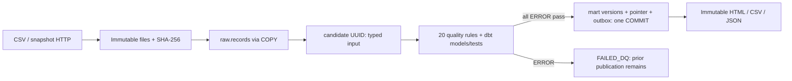

# dqflow

Ежедневная загрузка снимков заказов из CSV или HTTP API, двадцать правил качества,
версионированные витрины PostgreSQL и HTML/CSV/JSON-отчёты. Ошибочный снимок не
переключает текущую публикацию. Все демонстрационные данные синтетические.

## Быстрый запуск в Windows / Docker Desktop

Откройте PowerShell в этой папке. Docker Desktop должен работать в режиме Linux containers.
Скрипт создаёт случайные локальные секреты, собирает образ, создаёт роли и схему,
генерирует 200 000 строк и выполняет загрузку через HTTP:

```powershell
powershell -ExecutionPolicy Bypass -File ops/start-local.ps1
```

Откройте **http://127.0.0.1:8080**. Порты PostgreSQL, источника и mock webhook
не опубликованы на хосте. Первый запуск скачивает образы и Python-зависимости.

Пошагово:

```powershell
Copy-Item .env.example .env
docker compose -f compose.yaml -f compose.local.yaml build
docker compose -f compose.yaml -f compose.local.yaml run --rm bootstrap local-init
docker compose -f compose.yaml -f compose.local.yaml up -d --wait postgres source-demo mock-webhook
docker compose -f compose.yaml -f compose.local.yaml run --rm bootstrap-roles
docker compose -f compose.yaml -f compose.local.yaml run --rm runner migrate
docker compose -f compose.yaml -f compose.local.yaml up -d --wait report-web
docker compose -f compose.yaml -f compose.local.yaml run --rm runner doctor
docker compose -f compose.yaml -f compose.local.yaml run --rm runner demo generate --period 2026-09-30 --rows 200000 --seed 42
docker compose -f compose.yaml -f compose.local.yaml run --rm runner run --period 2026-09-30 --source demo
docker compose -f compose.yaml -f compose.local.yaml run --rm runner status --period 2026-09-30 --json
```

Report-web запускается **после миграций**: его healthcheck проверяет существование
таблиц публикации. Bootstrap ролей — отдельная одноразовая команда с admin-секретом.
Runner entrypoint — `dqflow`; секрет мигратора доступен runner только в локальном профиле.

## Локальная разработка без Docker

Нужны Python 3.12, uv 0.9.8 и PostgreSQL. `uv sync --frozen` устанавливает зависимости.
`config/local.yaml` использует CSV и PostgreSQL на `127.0.0.1:55432`.
Создайте отдельную БД `dqflow`, выполните `dqflow local-init`, затем настройте пароль
bootstrap-admin в `secrets/db_admin_password`, выполните `bootstrap-roles`, `migrate`, `doctor`.

```powershell
uv run dqflow demo generate --period 2026-09-30 --rows 200000 --seed 42
uv run dqflow run --period 2026-09-30 --source demo
uv run dqflow serve --port 8080
```

`config/native-http.yaml` — профиль проверенной на этой машине HTTP-демонстрации:
БД `dqflow_demo`, API `127.0.0.1:18000`, mock webhook `127.0.0.1:18001`.
Источник запускается `dqflow serve --kind source --port 18000`, mock —
`dqflow serve --kind mock --port 18001`. Конфигурация выбирается через `DQFLOW_CONFIG`.

Автоматизированный нативный запуск в Windows: `powershell -ExecutionPolicy Bypass -File ops/start-native.ps1`.
Скрипт использует установленный PostgreSQL 17/18 и uv, создаёт отдельный локальный кластер
при его отсутствии и запускает сервисы скрытыми фоновыми процессами.

## Команды

| Команда | Назначение |
|---|---|
| `doctor` | Конфигурация, доступность схемы, доступ reader, запись артефактов, свободный диск |
| `migrate` | Alembic, отдельная роль migrator |
| `demo generate --period D --rows N --seed S [--scenario NAME]` | Детерминированный источник; N кратно 20 или равно 0 |
| `run --period D --source demo` | Загрузка, 20 правил, dbt build/test, публикация, отчёт, outbox |
| `status --period D --json` | Отдельные состояния публикации, отчёта, уведомления и последней попытки |
| `report --period D` | Повтор рендера текущего run_id без загрузки |
| `retry --run-id UUID` | Повтор исходного snapshot; отдельный attempt_id |
| `backfill --from D1 --to D2 --source demo` | Обе даты включены; остановка на первой ошибке |
| `rollback --period D --to-run-id UUID --reason TEXT` | Переключение проверенной версии с аудитом |
| `schedule tick` | После 05:00 догоняет отсутствующие даты последних 7 дней |
| `outbox drain` | Атомарное резервирование событий через FOR UPDATE SKIP LOCKED |
| `acceptance --profile local` | Unit/integration-тесты; JUnit в `data/acceptance.xml` |
| `benchmark --rows 200000 --repeat 20 [--baseline]` | Реальные повторные загрузки в отдельных dataset; JSON с замерами |
| `cleanup` | Удаление просроченного raw неуспешных запусков после подтверждённой внешней копии |
| `backup-confirmed --reference TEXT` | Отметка проверенной внешней копии; вызывается backup.sh после roundtrip |
| `serve [--kind reports|source|mock]` | Локальный HTTP-сервис |

Даты строго `YYYY-MM-DD`. `--source demo` использует настроенный тип CSV/HTTP;
допустимо также имя настроенного типа. Все CLI-команды: `dqflow --help`.

Коды выхода: **0** успех/no-op, **2** конфигурация/параметры, **3** качество,
**4** источник, **5** инфраструктура, **6** публикация есть, отчёт ожидается,
**75** занята блокировка. JSON в stdout; стадии в JSON-логах stderr.

Сценарии генератора: `clean`, `duplicate`, `null`, `decimal`, `status`,
`missing_customer`, `missing_item`, `orphan_payment`, `currency`, `negative`,
`over_refund`, `unpaid`, `wrong_total`, `future`, `empty_id`, `incomplete`,
`corrupt`, `schema`, `warning`, `source_sum`.

```powershell
# Испорченная новая поставка заблокируется, корректная публикация останется доступна.
uv run dqflow demo generate --period 2026-09-30 --rows 200000 --seed 43 --scenario duplicate
uv run dqflow run --period 2026-09-30 --source demo
uv run dqflow status --period 2026-09-30 --json
```

## Проверка разработки

```powershell
uv run ruff check src tests
uv run mypy src/dqflow
uv run pytest -q tests/unit
$env:DQFLOW_INTEGRATION='1'
uv run pytest -q tests --junitxml=data/acceptance.xml
```

Integration-тесты запускайте на отдельной локальной БД. Они создают dataset с
префиксом `test_` и сохраняют аудит, не удаляя рабочие таблицы.

## Как устроена публикация



Платежи и позиции сначала агрегируются независимо. День определяется в
Asia/Qyzylorda, суммы — Decimal / numeric(18,2). `as_of` описывает состояние оплаты
заказов периода, а не банковский оборот дня. Пустой подтверждённый день публикуется с нулями.
DQ19 требует четыре предыдущих сопоставимых дня; до этого — NOT_EVALUATED.

Подробности: [контракт](docs/data-contract.md), [развёртывание](docs/deployment.md),
[эксплуатация](docs/runbook.md), [безопасность](docs/security.md),
[версии](docs/versions.md), [приёмка](docs/acceptance-report.md),
[замеры](docs/benchmark.md).

Готовый пример: [HTML-отчёт](docs/example-report/summary.html),
[сводка CSV](docs/example-report/summary.csv), [результаты проверок JSON](docs/example-report/quality.json).
Архив исходников собирается `python ops/package.py`; секреты, виртуальное окружение,
рабочие БД и raw в него не включаются.

## Границы готовности

Это воспроизводимый пилот на синтетическом источнике. Конкретный production-источник,
VPS, registry, TLS-домен, операторы и внешнее backup-хранилище пользователем не предоставлены.
Факт локального теста не означает приёмку этих внешних систем. Точный перечень
выполненных проверок и непроверенных пунктов находится в отчёте приёмки.
Инкрементальная загрузка/CDC не реализована: версия 1 работает с полными снимками дня.
