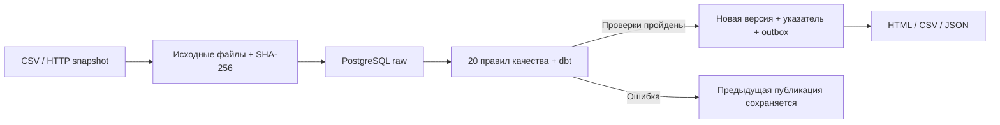

# AutoReport

Ежедневные отчёты по заказам с проверкой качества исходных данных. Сервис загружает снимок из CSV или HTTP API, проверяет его по 20 правилам и публикует витрины PostgreSQL и отчёты HTML, CSV и JSON. Если новая поставка содержит ошибки, предыдущая корректная публикация остаётся доступной.

**Python 3.12 · PostgreSQL · dbt · FastAPI · Docker · uv**

[](https://github.com/nekronusss/AutoReport/actions/workflows/ci.yml)

[Быстрый старт](#быстрый-старт) · [Результат](#что-появится-после-запуска) · [Разработка](#локальная-разработка) · [CLI](docs/cli.md) · [Документация](#документация)

**AutoReport** — название репозитория. Python-пакет, CLI-команда и Docker-проект называются **`dqflow`**: это одно приложение.

## Что делает приложение

- Принимает полные дневные снимки заказов, покупателей, позиций и платежей.
- Сохраняет исходные файлы и SHA-256 для воспроизведения загрузки.
- Проверяет типы, связи, суммы, дубликаты и полноту данных перед публикацией.
- Хранит версии витрин и переключает текущую публикацию одной транзакцией.
- Формирует HTML-отчёт, CSV-выгрузки и JSON с результатами проверок.
- Поддерживает повтор загрузки, backfill, откат версии и аудит попыток.
- Доставляет уведомления через outbox; предоставляет health endpoint и метрики.

В комплекте — синтетический HTTP/CSV-источник и mock webhook. Для подключения настоящей системы нужен источник по [контракту данных](docs/data-contract.md).

## Быстрый старт

### Требования

Нужны Git и работающий Docker Engine с Compose v2, поддерживающим `!override` (**2.24.4+**). На Windows используйте Docker Desktop в режиме Linux containers. Python и PostgreSQL на компьютере для Docker-запуска не требуются. Первый запуск скачивает образы и зависимости.

```sh
git clone https://github.com/nekronusss/AutoReport.git
cd AutoReport
```

Вместо Git можно скачать ZIP через **Code → Download ZIP** и открыть терминал в распакованной папке.

### Windows / PowerShell

```powershell
powershell -ExecutionPolicy Bypass -File ops/start-local.ps1
```

Скрипт создаёт локальные секреты, собирает образ, поднимает PostgreSQL, применяет миграции, генерирует 200 000 строк и выполняет загрузку через HTTP. Параметр `ExecutionPolicy` действует только на этот запуск PowerShell.

После завершения откройте **[http://127.0.0.1:8080](http://127.0.0.1:8080)**.

### Linux / macOS или ручной запуск

В Bash создайте `.env`, если его ещё нет:

```bash
test -f .env || cp .env.example .env
```

В PowerShell аналогичная команда: `if (!(Test-Path .env)) { Copy-Item .env.example .env }`.

Далее из корня репозитория, по порядку:

```sh
docker compose -f compose.yaml -f compose.local.yaml build
docker compose -f compose.yaml -f compose.local.yaml run --rm bootstrap local-init
docker compose -f compose.yaml -f compose.local.yaml up -d --wait postgres source-demo mock-webhook
docker compose -f compose.yaml -f compose.local.yaml run --rm bootstrap-roles
docker compose -f compose.yaml -f compose.local.yaml run --rm runner migrate
docker compose -f compose.yaml -f compose.local.yaml up -d --wait report-web
docker compose -f compose.yaml -f compose.local.yaml run --rm runner doctor
docker compose -f compose.yaml -f compose.local.yaml run --rm runner demo generate --period 2026-09-30 --rows 200000 --seed 42
docker compose -f compose.yaml -f compose.local.yaml run --rm runner run --period 2026-09-30 --source demo
```

Порядок важен: `report-web` проверяет наличие таблиц, поэтому запускается после миграций. Роли БД создаёт отдельная одноразовая команда `bootstrap-roles`.

Только веб-отчёт опубликован на хосте; PostgreSQL, источник и webhook доступны внутри Docker-сети. Это локальный стенд без пользовательских аккаунтов.

## Что появится после запуска

На главной странице выберите период **2026-09-30** и откройте отчёт. В нём находятся сводные показатели и результаты 20 проверок. Рядом доступны выгрузки; файлы сохраняются в `data/artifacts/`, исходные снимки — в `data/raw/`.

Контрольные показатели демонстрации с `seed=42`:

| Показатель | Значение |
| --- | ---: |
| Заказы | 50 000 |
| Покупатели | 10 000 |
| Сумма заказов | 24 747 750,00 ₸ |
| Получено за вычетом возвратов | 23 373 075,00 ₸ |

Итого 200 000 строк включает покупателей, заказы, позиции и платежи — это не 200 000 заказов. Данные полностью синтетические. Зафиксированные результаты и условия проверки приведены в [отчёте приёмки](docs/acceptance-report.md).

Без запуска можно посмотреть [пример CSV](docs/example-report/summary.csv) и [результаты проверок JSON](docs/example-report/quality.json). [HTML-пример](docs/example-report/summary.html) нужно скачать и открыть в браузере: GitHub показывает его исходный код.

Проверка состояния:

```sh
docker compose -f compose.yaml -f compose.local.yaml run --rm runner status --period 2026-09-30 --json
```

### Проверьте защиту публикации

Сгенерируйте новую поставку с дубликатом и загрузите тот же период:

```sh
docker compose -f compose.yaml -f compose.local.yaml run --rm runner demo generate --period 2026-09-30 --rows 200000 --seed 43 --scenario duplicate
docker compose -f compose.yaml -f compose.local.yaml run --rm runner run --period 2026-09-30 --source demo
docker compose -f compose.yaml -f compose.local.yaml run --rm runner status --period 2026-09-30 --json
```

Команда загрузки должна завершиться кодом **3**: новая попытка не прошла контроль качества. Предыдущая публикация останется доступна. Остальные сценарии генератора, команды и коды выхода — в [справочнике CLI](docs/cli.md).

## Как устроена обработка



Платежи и позиции агрегируются независимо, чтобы соединения не умножали суммы. День определяется в `Asia/Qyzylorda`, денежные значения обрабатываются через `Decimal` / `numeric(18,2)`. `as_of` описывает состояние оплаты заказов периода, а не банковский оборот дня.

Пустой подтверждённый день публикуется с нулями. Правилу DQ19 нужны четыре предыдущих сопоставимых дня; до их появления результат — `NOT_EVALUATED`.

## Остановка и повторный запуск

```sh
docker compose -f compose.yaml -f compose.local.yaml stop
docker compose -f compose.yaml -f compose.local.yaml start
```

База хранится в Docker volume, файлы — в локальных папках `data/` и `secrets/`. Сохраняйте их между запусками. `docker compose down -v` удаляет том PostgreSQL; для обычной остановки эта команда не нужна.

## Локальная разработка

Для работы вне Docker нужны **Python 3.12**, **uv 0.9.8** и PostgreSQL. Зависимости закреплены в `uv.lock`:

```sh
uv sync --frozen
```

Профиль `config/local.yaml` использует CSV и PostgreSQL на `127.0.0.1:55432`. Создайте отдельную БД `dqflow`, выполните `uv run dqflow local-init`, укажите пароль администратора БД в `secrets/db_admin_password`, затем выполните:

```sh
uv run dqflow bootstrap-roles
uv run dqflow migrate
uv run dqflow doctor
uv run dqflow demo generate --period 2026-09-30 --rows 200000 --seed 42
uv run dqflow run --period 2026-09-30 --source demo
uv run dqflow serve --port 8080
```

Для Windows есть автоматизированный [ops/start-native.ps1](ops/start-native.ps1): он использует установленный PostgreSQL 17/18 и uv, создаёт отдельный локальный кластер при его отсутствии и запускает HTTP-сервисы фоновыми процессами.

| Профиль | Назначение |
| --- | --- |
| [config/local.yaml](config/local.yaml) | Локальная разработка с CSV |
| [config/docker.yaml](config/docker.yaml) | Compose-стенд с HTTP-источником |
| [config/native-http.yaml](config/native-http.yaml) | Нативная HTTP-демонстрация: источник 18000, webhook 18001 |
| [config/prod.example.yaml](config/prod.example.yaml) | Образец для адаптации под production |

Профиль выбирается через `DQFLOW_CONFIG`. Полный список команд: `uv run dqflow --help`.

## Проверки

```sh
uv run ruff check src tests
uv run mypy src/dqflow
uv run pytest -q tests/unit
```

Для полного набора подготовьте **отдельную** БД с ролями и миграциями. В PowerShell:

```powershell
$env:DQFLOW_INTEGRATION = "1"
uv run pytest -q tests --junitxml=data/acceptance.xml
```

В Bash: `DQFLOW_INTEGRATION=1 uv run pytest -q tests --junitxml=data/acceptance.xml`. Интеграционные тесты создают dataset с префиксом `test_` и сохраняют аудит.

[GitHub Actions](.github/workflows/ci.yml) проверяет lint, типизацию, тесты с PostgreSQL/dbt, зависимости и сборку Docker-образа. Исторические результаты локальной проверки и ограничения стенда приведены в [приёмке](docs/acceptance-report.md); текущий статус CI виден в значке в начале страницы.

## Решение проблем

| Симптом | Что проверить |
| --- | --- |
| Docker daemon недоступен | Запустите Docker Desktop/Engine, проверьте `docker version`; на Windows нужен режим Linux containers |
| Compose не понимает `!override` | Обновите Compose до версии 2.24.4 или новее |
| Страница не открывается | Проверьте порт 8080, состояние `report-web` и завершение миграций |
| Ошибка доступа к БД | Выполнены ли `local-init`, `bootstrap-roles`, `migrate`; соответствуют ли секреты существующему кластеру |
| Загрузка завершилась кодом 3 | Не пройдены правила качества; изучите отчёт и последнюю попытку через `status` |
| Публикация есть, отчёта нет, код 6 | Повторите рендер командой `report --period YYYY-MM-DD`; подробности в runbook |

```sh
docker compose -f compose.yaml -f compose.local.yaml ps
docker compose -f compose.yaml -f compose.local.yaml logs --tail=100 report-web postgres
```

## Документация

| Документ | Содержание |
| --- | --- |
| [CLI](docs/cli.md) | Команды, коды выхода и сценарии генератора |
| [Контракт данных](docs/data-contract.md) | Форматы поставки и бизнес-правила |
| [Развёртывание](docs/deployment.md) | Docker, Linux VPS, backup/restore и выпуск |
| [Runbook](docs/runbook.md) | Повтор, откат и действия при сбоях |
| [Безопасность](docs/security.md) | Роли, секреты и доступ |
| [Версии](docs/versions.md) | Идентичность запусков и совместимость |
| [Приёмка](docs/acceptance-report.md) | Выполненные проверки и открытые пункты |
| [Замеры](docs/benchmark.md) | Методика и результаты измерений |
| [Участие в разработке](CONTRIBUTING.md) | Изменения, проверки и сообщения об ошибках |

```text
src/dqflow/       CLI, загрузка, проверки, отчёты и HTTP-сервисы
dbt/             SQL-модели и тесты витрин
config/          Профили конфигурации
tests/           Unit- и интеграционные тесты
ops/             Запуск, deployment, backup и мониторинг
docs/            Контракты, инструкции и примеры результатов
```

## Статус проекта

Это воспроизводимый пилот на синтетическом источнике. Для публичной эксплуатации требуется подключить реальный источник, настроить сервер, TLS и доступ к отчётам, внешние уведомления и резервные копии, затем провести проверку восстановления в целевом окружении. Подготовленные шаблоны описаны в [развёртывании](docs/deployment.md).

Версия 1 работает с полными снимками дня; CDC и инкрементальная загрузка не реализованы. Локальные тесты и замеры не являются подтверждением производительности или готовности конкретного production-стенда.
