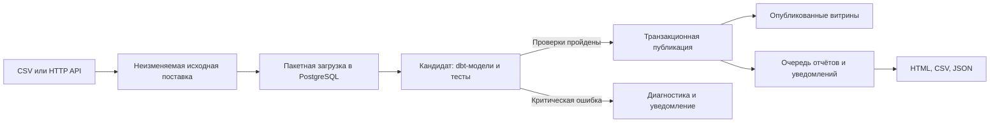

# Техническое задание: ETL, контроль качества данных и автоматическая отчётность

Версия: 1.0. Дата: 8 октября 2026 года.

**Статус:** спецификация для разработки. Код, контейнеры и сервер этим документом не создаются; приведённые команды определяют интерфейс, который должен реализовать исполнитель. Производительность и восстановление ещё не проверены.

**Выбранное направление:** загрузка данных, SQL-проверки, сверка показателей и автоматические отчёты. Среда принята как проектное допущение: разработка на Windows через Docker Desktop; эксплуатация на Linux VPS. Облачный провайдер не требуется для локальной демонстрации.

## 1. Что нужно создать и зачем

Создать проект `dqflow`: систему ежедневной обработки данных о заказах. Она получает согласованный набор данных, сохраняет исходные записи, проверяет полноту и бизнес-правила, формирует аналитические таблицы и публикует отчёт. При критической ошибке новая версия не попадает к потребителям, а последняя корректная версия остаётся доступной с явной датой актуальности.

Предметная область заказов выбрана для воспроизводимого учебного и пилотного проекта. Она позволяет показать те же инженерные навыки, что нужны при работе с корпоративной отчётностью: связи таблиц, денежные суммы, пропуски, повторная загрузка, исправления задним числом и аудит. Медицинские данные не используются.

Пользователи: аналитик, которому нужен готовый отчёт; инженер, который разбирает ошибки и перезапускает загрузку; владелец исходной системы, который исправляет данные.

| Задача в эксплуатации | Что делает система | Чем подтверждается польза |
| --- | --- | --- |
| Ручной запуск одинаковых SQL-проверок | Выполняет версионируемый набор правил по расписанию | Время работы аналитика до и после, результаты всех правил |
| Потеря части данных при загрузке | Сверяет объём, контрольные суммы и независимые итоги источника | Искусственно неполная поставка блокируется |
| Дубли после повторного запуска | Идентифицирует поставку и публикует версии идемпотентно | Повтор не меняет итоговые суммы |
| Некорректные цифры в отчёте | Проверяет кандидат перед публикацией | Ошибочная версия не становится текущей |
| Непонятно, почему отчёт устарел | Сохраняет стадии, ошибки и дату последней публикации | Видно конкретный источник или правило |
| Дорогая построчная обработка | Использует пакетную загрузку и SQL-агрегации | Сравнительный benchmark на одном наборе данных |

Не каждая компания нуждается в таком сервисе: разовую маленькую выгрузку проще обработать отдельным скриптом. Система оправданна при повторяющихся загрузках, нескольких связанных таблицах и потребителях, которым важны проверенные данные к определённому времени.

## 2. Найденные примеры и границы их применения

Источники просмотрены 08.10.2026. Публичное описание работающей платформы и демонстрационный репозиторий имеют разную доказательную ценность. Чужие показатели экономии не являются прогнозом для этого проекта.

| Пример | Тип | Что полезно изучить |
| --- | --- | --- |
| [GitLab Data Team Platform](https://handbook.gitlab.com/handbook/enterprise-data/platform/) | Публичная документация реальной корпоративной платформы | Идемпотентные пайплайны, слои данных, dbt, тесты и Trusted Data Framework |
| [dbt-labs/jaffle-shop](https://github.com/dbt-labs/jaffle-shop) | Открытый учебный проект | SQL-модели, зависимости, тесты, подготовка аналитических данных о заказах |
| [dlt: загрузка данных из API](https://dlthub.com/docs/tutorial/load-data-from-an-api) | Официальное руководство с кодом | Пагинация, пакетное получение данных, состояния загрузки и повторные попытки |
| [dlt: cursor-based incremental loading](https://dlthub.com/docs/general-usage/incremental/cursor) | Официальный пример инкрементальной загрузки | Курсор, границы диапазона и дубли на границе выгрузок |
| [Great Expectations: действия по результатам проверок](https://docs.greatexpectations.io/docs/core/trigger_actions_based_on_results/) | Документация инструмента | Связь валидации с уведомлениями и документацией результатов |

В этом ТЗ выбран dbt для SQL-моделей и SQL-тестов. Great Expectations и dlt рассматриваются как дополнительные варианты, а не обязательные зависимости. Использование всех инструментов одновременно не требуется. `jaffle-shop` служит образцом организации проекта: его текущую ветку нельзя автоматически считать совместимой с выбранными версиями локального dbt и PostgreSQL.

## 3. Объём первой версии

Обязательно реализовать:

1. Два способа получения одной и той же поставки: каталог CSV с manifest и HTTP API с пагинацией.
2. Детерминированный генератор тестовых данных и демонстрационный API с управляемыми сбоями.
3. Четыре сущности: клиенты, заказы, позиции заказов и платежи.
4. Изолированную обработку каждой поставки, минимум 15 правил качества, журнал результатов.
5. Две итоговые таблицы: детализация по заказам и ежедневные показатели.
6. HTML-отчёт, CSV-выгрузки, JSON с результатами проверок.
7. Повторный запуск, перерасчёт периода, защиту от параллельной обработки и атомарную публикацию.
8. Docker-окружения, миграции, CI, расписание на VPS, мониторинг, резервирование и проверенное восстановление.

Базовая версия получает **полный снимок выбранного отчётного периода**, а не всю историю компании. Это намеренный выбор для объёма около 200 тысяч строк: проще доказать полноту и воспроизвести расчёт. Инкрементальная доставка изменений определена отдельно в разделе 20 и не блокирует приёмку первой версии.

Не входят в первую версию: Kafka, Spark, Kubernetes, высокая доступность, потоковая аналитика, автоматическое исправление исходных данных, интерфейс редактирования правил пользователями, валютная конвертация и расчёт официальной финансовой отчётности. Oracle-коннектор можно добавить после получения реального доступа и схемы источника.

## 4. Архитектура и стек



| Компонент | Решение | Назначение |
| --- | --- | --- |
| Прикладной код | Python 3.12, HTTPX, Pydantic, psycopg 3, Typer | Коннекторы, контракты, CLI и управление выполнением |
| Обработка SQL | dbt Core и совместимый `dbt-postgres` | Преобразования, зависимости и тесты |
| Хранилище | PostgreSQL 17, актуальный поддерживаемый minor | Исходные данные, кандидаты, витрины и метаданные |
| Миграции служебных таблиц | Alembic | Контролируемое изменение схемы |
| Отчёты | Jinja2, HTML, стандартный CSV и JSON | Доставка результатов без отдельного SPA |
| Среда | Docker Engine / Docker Desktop, Compose | Воспроизводимость локального запуска и VPS |
| Расписание | systemd timers на Linux | Запуски, догоняющая обработка, обслуживание |
| Контроль | Структурированные логи, Prometheus и Alertmanager | Состояние запусков и инфраструктуры |
| CI | GitHub Actions | Тесты, сборка и публикация образа |

Конкретные версии Python-пакетов исполнитель фиксирует в lock-файле после проверки совместимости. Релиз не принимается с неограниченными зависимостями или тегами образов `latest`. Версии пакетов, базового образа и PostgreSQL заносятся в `docs/versions.md`; образ приложения закрепляется по digest.

Подключение dbt к PostgreSQL описано в [официальной инструкции](https://docs.getdbt.com/docs/local/connect-data-platform/postgres-setup). Поддержка веток PostgreSQL проверяется по [политике версий](https://www.postgresql.org/support/versioning/). Эти ссылки не заменяют интеграционный тест конкретного lock-файла.

## 5. Контракт данных

### 5.1. Границы периода

Отчётный период по умолчанию: один календарный день в `Asia/Qyzylorda`; настройка обязательна и может быть изменена. В PostgreSQL временные отметки хранятся как `timestamptz`, системные логи выводятся в UTC. Период задаётся полуинтервалом `[начало, конец)` после перевода локальных границ в UTC.

В поставку входят заказы, созданные в этом периоде, все их позиции и все относящиеся к ним платежи, известные на момент `as_of`. Клиенты включаются только для этих заказов. Платёж может иметь дату за пределами периода заказа. Отчёт называется «Заказы периода и состояние их оплаты на as_of»; его нельзя выдавать за банковский оборот за этот день.

### 5.2. Таблицы

| Таблица | Ключ | Обязательные поля |
| --- | --- | --- |
| `customers` | `customer_id` | `customer_id`, `created_at`, `updated_at` |
| `orders` | `order_id` | `order_id`, `customer_id`, `created_at`, `updated_at`, `status`, `currency`, `total_amount` |
| `order_items` | `(order_id, line_id)` | `order_id`, `line_id`, `sku`, `quantity`, `unit_price`, `updated_at` |
| `payments` | `payment_id` | `payment_id`, `order_id`, `kind`, `status`, `amount`, `currency`, `occurred_at`, `updated_at` |

ID передаются строками, пустые строки запрещены. Имена, телефоны, адреса и email клиентов не нужны. Денежные значения передаются строкой десятичного числа и хранятся как `numeric(18,2)`; расчёты через float запрещены. `quantity` является положительным целым числом; денежные суммы неотрицательны.

Статусы заказов: `pending`, `completed`, `cancelled`. Типы платежей: `payment`, `refund`; статусы платежей: `pending`, `succeeded`, `failed`. Первая версия работает в одной настраиваемой валюте, по умолчанию KZT. Чужая валюта блокирует публикацию; неявного сложения валют быть не должно.

Стоимость заказа равна сумме `quantity * unit_price`; скидки и налоги отдельно в первой версии не моделируются. Для `completed` чистая сумма успешных оплат равна стоимости заказа. У `pending` допустима частичная оплата. У `cancelled` положительный остаток оплаты обозначается предупреждением о возврате.

### 5.3. Manifest поставки

Каждая поставка сопровождается версионируемым manifest: `source`, `schema_version`, `snapshot_id`, `period_start`, `period_end`, `as_of`, `complete`, список четырёх таблиц, количество строк каждой таблицы, SHA-256 файлов или страниц, контрольные суммы денежных полей отдельно по валюте.

Manifest создаётся на стороне источника из того же согласованного снимка, что и данные. Проверка суммы, вычисленной дважды уже внутри хранилища, не считается независимой сверкой с источником. Для реального внедрения владелец источника должен подтвердить механизм согласованного снимка. Без него нельзя обещать полноту изменяющегося API.

Для CSV: UTF-8, заголовок, разделитель `,`, кавычка `"`, правила NULL и escape задокументированы; архив распаковывается с защитой от выхода путей за рабочий каталог. Для API: неизменяемый `snapshot_id`, непрозрачный `next_cursor`, последняя страница и ожидаемое количество записей. Все страницы относятся к одному снимку. Наличие `updated_at` само по себе не доказывает корректную инкрементальную загрузку.

API v1 демонстрационного источника:

```text
GET /v1/snapshots?period=2026-09-30
GET /v1/snapshots/{snapshot_id}/manifest
GET /v1/snapshots/{snapshot_id}/{table}?cursor={cursor}&limit=5000
```

Адреса следующих страниц ограничены разрешённым хостом источника. HTTP-клиент не должен переносить токен авторизации на чужой домен после redirect.

## 6. Загрузка, ошибки и повторные попытки

1. Проверить конфигурацию, доступность БД и валидность manifest.
2. Получить блокировку для пары `environment + dataset`; первая версия выполняет один запуск набора данных одновременно.
3. Создать `run_id`, зафиксировать снимок, версию кода, конфигурации и правил.
4. Скачать страницы/файлы потоково; сохранить их неизменяемыми с контрольными суммами.
5. Проверить завершённость поставки и сверить manifest; неполная поставка не проходит дальше.
6. Загрузить записи пакетами через PostgreSQL COPY; сохранять `run_id`, таблицу, порядковый номер, исходное содержимое и хеш.
7. Выполнить предварительную проверку типов и обязательных полей, затем построить кандидат и выполнить dbt-тесты.
8. При успехе опубликовать новую версию; при ошибке сохранить диагностику, не меняя опубликованные данные.

Исходный слой допускает проблемные записи, чтобы дефект не исчезал из диагностики. Некорректный cast не должен обрывать импорт без указания строки: записи с ошибками структуры попадают в `meta.rejected_records`, а весь запуск получает критическую ошибку. В первой версии публикация частично очищенной поставки запрещена.

HTTP: таймаут соединения 5 секунд, чтения 60 секунд; максимум 5 попыток. Повторять timeout, 408, 429 и временные 5xx; учитывать `Retry-After`, использовать exponential backoff с jitter и общим deadline. При ожидании сверх deadline завершать запуск с диагностикой. 400, 401, 403 и нарушение контракта не повторять автоматически без изменения условий.

Пакет по умолчанию: 5 000 строк, настраиваемый. В память не загружается вся поставка. Один зависший SQL-запрос ограничивается `statement_timeout`, блокировка - `lock_timeout`. Начальные значения 300 и 10 секунд, с отдельным обоснованным исключением для миграций.

Идентификатор логической обработки: источник + период + snapshot_id + версия кода + хеш конфигурации и правил. Повтор успешно завершённой комбинации возвращает ссылку на существующий результат. Техническая попытка получает отдельный `attempt_id`. Изменение кода или исправленный снимок создаёт новую версию.

Сбой после приёма части строк не означает успех. Повтор проверяет ранее сохранённые хеши и либо продолжает подтверждённую поставку, либо заново строит кандидат из неизменяемых файлов. Публикация при этом остаётся идемпотентной.

## 7. Правила качества

Каждое правило имеет ID, описание, версию, серьёзность, SQL или валидатор, порог, число нарушений, длительность и до 20 диагностических ID. Полные персональные данные в результатах не сохраняются.

| ID | Проверка | Реакция |
| --- | --- | --- |
| DQ01 | Присутствуют все 4 таблицы и manifest с `complete=true` | Блокировка |
| DQ02 | Совпадают хеши и количество исходных строк | Блокировка |
| DQ03 | Схема, обязательные поля и типы соответствуют версии контракта | Блокировка |
| DQ04 | ID и составные ключи заполнены | Блокировка |
| DQ05 | Бизнес-ключи уникальны в снимке до устранения дублей | Блокировка |
| DQ06 | У каждого заказа существует клиент | Блокировка |
| DQ07 | У каждой позиции и каждого платежа существует заказ | Блокировка |
| DQ08 | У каждого заказа есть хотя бы одна позиция | Блокировка |
| DQ09 | Статусы и типы платежей входят в разрешённые наборы | Блокировка |
| DQ10 | Количество положительно, суммы неотрицательны, точность допустима | Блокировка |
| DQ11 | Валюта разрешена и согласована между заказом и платежами | Блокировка |
| DQ12 | Сумма позиций равна сумме заказа с точностью до 0,01 | Блокировка |
| DQ13 | У завершённого заказа чистая успешная оплата равна сумме заказа | Блокировка |
| DQ14 | Успешные возвраты не превышают успешные оплаты заказа | Блокировка |
| DQ15 | Заказы принадлежат периоду; даты логичны и не позже as_of | Блокировка |
| DQ16 | Контрольные количества и суммы источника равны результатам загрузки | Блокировка |
| DQ17 | Витрина сверяется с независимым расчётом на типизированном исходном слое | Блокировка |
| DQ18 | Есть ожидаемая поставка для каждой даты бизнес-календаря | Блокировка публикации отсутствующей даты и сигнал |
| DQ19 | Объём отличается более чем на 50% от медианы сопоставимых дней | Предупреждение |
| DQ20 | У отменённых заказов остались невозвращённые успешные оплаты | Предупреждение |

Для DQ19 нужны минимум 4 ранее опубликованных сопоставимых дня; иначе результат `NOT_EVALUATED`, а не `PASS`. Проверку пропущенной даты выполнять по календарю ожидаемых поставок: день с нулём заказов допустим, если источник подтвердил полный пустой снимок.

`ERROR` блокирует публикацию. `WARN` публикуется с пометкой. Отключение или понижение серьёзности правила допускается только версионируемым изменением конфигурации с причиной; параметра `--ignore-all-errors` не должно быть.

В dbt использовать стандартные `unique`, `not_null`, `relationships`, `accepted_values` и отдельные SQL-тесты бизнес-правил. Сохранять `manifest.json` и `run_results.json`. Ненулевой exit code, отсутствующий результат обязательного теста или `SKIP` зависимого критического теста означают запрет публикации. Механика тестов описана в [документации dbt](https://docs.getdbt.com/docs/build/data-tests).

## 8. Хранилище, версии и публикация

Схемы PostgreSQL:

| Схема | Содержимое и доступ |
| --- | --- |
| `raw` | Записи поставок с `run_id`; потребители не имеют доступа |
| `candidate_<run_id>` | Типизированные модели и результаты расчёта отдельного запуска; имя формируется из UUID по allowlist |
| `mart` | Версионированные факты и агрегаты с `run_id`; потребители читают только представления текущей версии |
| `meta` | Запуски, попытки, правила, ошибки, публикации, очередь отчётов, аудит |

Обязательные служебные таблицы: `runs`, `attempts`, `source_batches`, `check_results`, `rejected_records`, `publications`, `report_artifacts`, `outbox`, `audit_events`. Для каждой определить PK, FK, уникальные ограничения и индексы миграциями. В `publications` ровно одна текущая версия для `dataset + period`.

Опубликованные модели:

- `fact_orders_versions`: одна строка на `(run_id, order_id)` с суммой позиций, успешными оплатами, возвратами и чистой оплатой. Сначала агрегировать платежи и позиции независимо, затем соединять с заказами: прямой JOIN двух таблиц «один ко многим» размножает суммы.
- `daily_summary_versions`: одна строка на `(run_id, business_date, currency)` с количеством заказов и клиентов, стоимостью заказов, успешными оплатами, возвратами и чистой оплатой.
- `current_orders` и `current_daily_summary`: представления, которые выбирают только run_id из `meta.publications`.

Формулы отчёта фиксируются явно: `orders_count` - все заказы периода; `customers_count` - уникальные клиенты этих заказов; `ordered_amount` - стоимость заказов со статусом, отличным от cancelled; `captured_amount` - сумма succeeded-платежей типа payment по всем заказам периода; `refunded_amount` - сумма succeeded-платежей типа refund; `net_collected_amount = captured_amount - refunded_amount`. Остатки отменённых заказов входят в денежные показатели и отдельно отмечаются DQ20. Сверка DQ16 использует также техническую сумму всех заказов, включая отменённые, чтобы фильтр бизнес-метрики не скрывал потерю строк. Пустой подтверждённый день создаёт строку календаря с нулевыми показателями.

Публикация выполняется одной транзакцией: вставка проверенных версий в `mart`, переключение указателя периода, фиксация статуса и запись события в `outbox`. До COMMIT читатель видит предыдущую версию, после COMMIT - новую. Многошаговый отчёт читает конкретный run_id, а не меняющийся указатель.

Блокировка удерживается отдельным живым соединением PostgreSQL; транзакция публикации использует это же соединение. Потеря соединения останавливает публикацию: автоматически переподключиться и продолжить её без повторной блокировки нельзя. Heartbeat нужен для диагностики, но не заменяет блокировку. Возможности advisory locks описаны в [PostgreSQL](https://www.postgresql.org/docs/17/explicit-locking.html).

Более старый `as_of` не может незаметно заменить новый. Откат на предыдущую проверенную версию выполняется отдельной командой с причиной и записью в аудите. Неопределённый результат COMMIT после сетевого сбоя разрешается чтением `publications` и уникального ключа операции, а не повторной слепой вставкой.

Ссылка «текущий отчёт» вычисляется через тот же указатель публикации и run_id. При новой публикации или rollback нельзя показывать отчёт другой версии как текущий: до готовности соответствующего артефакта отображается статус ожидания, а предыдущий отчёт доступен только как явно обозначенный архивный.

Состояния: `CREATED`, `EXTRACTING`, `LOADING`, `VALIDATING`, `PUBLISHING`, `PUBLISHED_REPORT_PENDING`, `SUCCEEDED`, `SUCCEEDED_WITH_WARNINGS`, `FAILED_SOURCE`, `FAILED_DQ`, `FAILED_TECH`, `CANCELLED`. Доставка уведомления имеет собственное состояние и не меняет факт успешной публикации данных.

## 9. Отчёты и уведомления

Каждый отчёт содержит период, as_of источника, run_id, версию кода, время формирования, статус качества, предупреждения, показатели и результаты всех правил. Отображать последнюю успешную версию и её возраст; запрещено маркировать старые данные сегодняшней датой как новый результат.

Артефакты: `summary.html`, `summary.csv`, `quality.json`, `failed_records.csv` с ограниченным количеством обезличенных примеров. CSV корректно экранируется; текстовые поля, начинающиеся с символов формул электронных таблиц, обезвреживаются. HTML строится с autoescape. Отчёт не выполняет произвольный HTML из источника.

Рендерер читает опубликованный run_id, записывает файлы во временный каталог, проверяет хеши и атомарно переименовывает каталог на том же файловом разделе. Повторная обработка события не создаёт второй логический отчёт. Сбой рендеринга оставляет состояние `PUBLISHED_REPORT_PENDING`; повтор отчёта не перезагружает данные.

Для локального профиля ссылка на отчёт доступна на `http://127.0.0.1:8080` после реализации проекта. Для production обязательны TLS и аутентификация на reverse proxy; к кандидатам и исходным файлам HTTP-доступ отсутствует. В уведомлении передавать краткий статус и защищённую ссылку, а не исходные записи или пароль.

Уведомления: webhook для критической ошибки, успешного первого выпуска, восстановления после сбоя и предупреждений. Повторы с ограничением, ключ идемпотентности `event_id`, журнал попыток. Принимающая сторона должна поддерживать дедупликацию; без неё допустима повторная доставка, гарантировать exactly-once нельзя. В локальном профиле использовать mock webhook.

## 10. Оптимизация и измерение результата

Обязательные оптимизации: COPY вместо одиночных INSERT, ограниченные буферы, SQL-агрегации, индексы по run_id и ключам соединения, обработка выбранного периода, повторное использование идентичного результата. После загрузки обновлять статистику кандидата через ANALYZE. Партиционирование вводить только после подтверждённой необходимости.

Предусмотреть baseline-скрипт с теми же правилами и последовательной обработкой. Нельзя сравнивать полный набор проверок с ускоренным запуском, который выполняет лишь часть правил. Для SQL сохранить `EXPLAIN (ANALYZE, BUFFERS)` на тестовой копии. Рекомендации по массовой загрузке: [PostgreSQL: Populating a Database](https://www.postgresql.org/docs/current/populate.html).

Приёмочный стенд: Linux, 4 vCPU, 8 ГБ RAM, SSD, Docker; исходный API находится в локальной сети стенда. Набор 200 000 строк суммарно: 10 000 клиентов, 50 000 заказов, 90 000 позиций, 50 000 платежей. Входной набор, seed, размер, конфигурация и ограничения контейнеров фиксируются в benchmark-отчёте.

**Цели, а не уже достигнутые результаты:** полный запуск p95 не более 10 минут; проверки качества отдельно p95 не более 2 минут; память runner не более 2 ГиБ. Провести 20 измерений на изолированном стенде, отдельно зафиксировать холодный запуск и метод расчёта p95. В каждый повтор включать реальную обработку: cache hit/идемпотентный no-op не считается benchmark.

Если цель не выполнена, исполнитель предоставляет профиль, причину и результат оптимизации. Снижение порога качества для достижения скорости запрещено. Время ручной работы аналитика измеряется отдельно от CPU-времени; нельзя заявлять «сократил с 2 часов до 20 минут» без собственного замера.

## 11. Структура репозитория и интерфейсы

```text
dqflow/
  README.md
  pyproject.toml
  uv.lock
  Dockerfile
  compose.yaml
  compose.local.yaml
  compose.prod.yaml
  .env.example
  src/dqflow/
    cli.py
    settings.py
    connectors/             # CSV и HTTP; общий контракт поставки
    ingestion/              # потоковое чтение, COPY и контроль файлов
    orchestration/          # состояния, блокировки, повторы
    validation/             # входные контракты и чтение результатов dbt
    publication/            # транзакционная публикация и откат
    reporting/              # HTML, CSV, JSON и обработчик outbox
    monitoring/             # метрики и health-команды
  dbt/
    dbt_project.yml
    profiles.yml            # только ссылки на окружение, без паролей
    models/
    tests/
    macros/
  migrations/
  config/
    local.yaml
    prod.example.yaml
    rules.yaml
  demo/
    generator.py
    api.py
    scenarios/
  tests/
    unit/
    integration/
    acceptance/
    performance/
  ops/
    deploy.sh
    backup.sh
    restore.sh
    systemd/
    monitoring/
  docs/
    data-contract.md
    deployment.md
    runbook.md
    security.md
    versions.md
    benchmark.md
    acceptance-report.md
  .github/workflows/
```

CLI-команды, обязательные к реализации:

| Команда | Поведение |
| --- | --- |
| `dqflow doctor` | Проверка конфигурации, БД, хранилища, прав и версии схемы; без загрузки данных |
| `dqflow migrate` | Применение миграций отдельной ролью |
| `dqflow demo generate --period D --rows N --seed S` | Создание согласованной демонстрационной поставки |
| `dqflow run --period D --source NAME` | Полный цикл для периода; JSON-резюме в stdout |
| `dqflow status --period D --json` | Состояния данных, отчёта и уведомлений по отдельности |
| `dqflow report --period D` | Повтор формирования отчёта для опубликованного run_id |
| `dqflow backfill --from D1 --to D2 --source NAME` | Последовательный перерасчёт диапазона, обе даты включены |
| `dqflow retry --run-id UUID` | Новая техническая попытка с проверкой допустимости продолжения |
| `dqflow rollback --period D --to-run-id UUID --reason TEXT` | Переключение на сохранённую проверенную версию, аудит |
| `dqflow schedule tick` | Определить ожидаемые периоды, поставить пропущенные и повторяемые задания |
| `dqflow outbox drain` | Обработать ожидающие отчёты и уведомления |
| `dqflow acceptance --profile local` | Автоматизированные приёмочные сценарии |
| `dqflow benchmark --rows 200000 --repeat 20` | Воспроизводимые измерения без no-op повторов |

Глобальная настройка: `DQFLOW_CONFIG=/app/config/local.yaml` или production-путь. Даты принимаются строго в ISO `YYYY-MM-DD`. Неизвестное поле конфигурации вызывает ошибку. Значения SQL передаются параметрами, динамические имена таблиц формируются только из доверенного allowlist.

Коды завершения: 0 - задача успешно выполнена или идентичный результат уже существует; 2 - неверная конфигурация/контракт; 3 - критическое нарушение качества; 4 - недоступный источник; 5 - ошибка БД/инфраструктуры; 6 - данные опубликованы, отчёт пока не готов; 75 - запуск отложен из-за блокировки. JSON-резюме всегда уточняет состояние. Планировщик не считает код 75 успехом свежести данных.

`run` по умолчанию после публикации обрабатывает относящиеся к нему события outbox и ждёт готовности отчёта не более 120 секунд. Поэтому локальный пример работает без фонового планировщика. Если отчёт не готов, возвращается код 6; уведомление может оставаться в очереди независимо от кода успеха отчёта. Фоновый outbox и inline-обработчик используют атомарное резервирование события и не выполняют его одновременно.

## 12. Конфигурация и секреты

Обязательные параметры: среда, dataset, timezone, source URL/каталог, ожидаемая валюта, срок готовности источника, deadline отчёта, размер batch, таймауты, число попыток, срок хранения, ограничения памяти, endpoint уведомлений, каталог артефактов.

Пример структуры, которую должен валидировать код:

```yaml
environment: local
dataset: orders
timezone: Asia/Qyzylorda
currency: KZT
source:
  type: http
  base_url: http://source-demo:8000
  batch_rows: 5000
  token_file: /run/secrets/source_token
database:
  host: postgres
  port: 5432
  database: dqflow
  user: dqflow_runner
  password_file: /run/secrets/db_runner_password
pipeline:
  max_runtime_seconds: 1800
  source_ready_local: '04:30'
  start_local: '05:00'
  report_deadline_local: '06:00'
  automatic_catchup_days: 7
artifacts:
  root: /data/artifacts
```

Пароли, source token, ключ резервного хранилища и webhook credentials передавать файлами секретов. `.env` используется только для несекретных параметров. В production секреты не входят в образ, Git, аргументы процесса, CI-логи или URL. Compose secrets предоставляют секреты сервисам файлами; защита этих файлов на хосте остаётся обязанностью администратора. Основание: [Docker Compose secrets](https://docs.docker.com/compose/how-tos/use-secrets/).

Роли БД: bootstrap-admin только для первоначальной подготовки; migrator для DDL; runner для raw/candidate/meta; publisher для операции публикации; report-reader только для опубликованных данных. Разделение ролей не заменяет изоляцию среды: dev и production используют разные базы, учётные записи и каталоги.

У orchestrator два типа соединений: runner для загрузки/моделей и выделенное publisher-соединение для удержания блокировки и финального COMMIT. Учётные данные migrator доступны только заданию миграции. Права SELECT publisher на кандидат и report-reader на исторические опубликованные версии выдаются явно; прямого чтения raw у report-reader нет.

Runner работает без root и без Docker socket; исходные каталоги монтируются read-only. PostgreSQL не публикуется в интернет. Для внешней БД использовать TLS с проверкой сертификата. Контрольные примеры ошибок содержат только технические идентификаторы.

## 13. Локальный запуск на Windows

Предпосылки: Git, поддерживаемая Windows, Docker Desktop с Linux containers и WSL 2. Для полного стенда желательно выделить Docker 4 CPU и 8 ГБ RAM; на компьютере потребуется запас памяти сверх этого. Требования установки проверяются по [инструкции Docker](https://docs.docker.com/desktop/setup/install/windows-install/).

Исполнитель должен обеспечить следующий сценарий **после создания кода**. Команды запускаются из корня будущего репозитория в PowerShell; они не работают только на основании этого ТЗ.

```powershell
Copy-Item .env.example .env
docker compose -f compose.yaml -f compose.local.yaml build
docker compose -f compose.yaml -f compose.local.yaml run --rm bootstrap local-init
docker compose -f compose.yaml -f compose.local.yaml up -d --wait postgres source-demo report-web mock-webhook
docker compose -f compose.yaml -f compose.local.yaml run --rm runner migrate
docker compose -f compose.yaml -f compose.local.yaml run --rm runner doctor
docker compose -f compose.yaml -f compose.local.yaml run --rm runner demo generate --period 2026-09-30 --rows 200000 --seed 42
docker compose -f compose.yaml -f compose.local.yaml run --rm runner run --period 2026-09-30 --source demo
docker compose -f compose.yaml -f compose.local.yaml run --rm runner status --period 2026-09-30 --json
docker compose -f compose.yaml -f compose.local.yaml run --rm runner acceptance --profile local
```

`bootstrap local-init` создаёт случайные локальные секреты и каталоги; production-режим в этой команде запрещён. Сервис `runner` имеет entrypoint `dqflow`. Локальный запуск `migrate` использует настроенную отдельную роль мигратора. Конфигурация источника и директория demo должны совпадать у generator и `source-demo`.

Ожидаемый результат: состояния `SUCCEEDED`, 20 результатов качества с допустимым `NOT_EVALUATED` у DQ19 на первом запуске, доступный HTML, CSV и JSON, запись о принятом mock webhook. В эталонной чистой поставке нет предупреждений DQ20. Адрес отчёта: `http://127.0.0.1:8080`; порты БД и демонстрационного API по умолчанию наружу не публикуются.

Демонстрация обязательна в двух режимах: чистые данные проходят; испорченные данные блокируются с понятным указанием правила. Копирование только скриншота успешного запуска приёмку не заменяет.

## 14. Развёртывание на Linux VPS

### 14.1. Граница применимости

Базовый production-профиль предназначен для небольшой внутренней ежедневной отчётности: один VPS, один активный pipeline, допустимое восстановление после аварии в течение нескольких часов. Один VPS является единой точкой отказа. При требовании непрерывной доступности понадобятся отдельная отказоустойчивая БД, внешний планировщик и другое проектирование.

Стартовая конфигурация для испытаний: 4 vCPU, 8 ГБ RAM, 100 ГБ SSD, поддерживаемая Ubuntu LTS. Это оценка для стенда, а не гарантия ёмкости. Перед внедрением измерить размер raw, WAL, индексов, журналов и версий; резервировать место минимум на две крупнейшие одновременные поставки и запас 30%.

Docker Compose допускает production-развёртывание на одном сервере; отдельные настройки production и порядок обновления описаны в [Docker Docs](https://docs.docker.com/compose/how-tos/production/). Docker Engine установить по [инструкции для Ubuntu](https://docs.docker.com/engine/install/ubuntu/).

### 14.2. Сервисы и постоянные данные

Всегда включены: `postgres`, `report-web`, `metrics-exporter`, `prometheus`, `alertmanager`. Runner, migrator, backup и обработчик outbox запускаются заданиями. `source-demo` и mock webhook существуют только в dev/staging; реальная эксплуатация использует источник заказчика.

Постоянные пути: `/srv/dqflow/postgres`, `/srv/dqflow/raw`, `/srv/dqflow/artifacts`, `/srv/dqflow/logs`. Конфигурация и секреты: `/etc/dqflow`, права чтения ограничены соответствующими сервисами. Релизы: `/opt/dqflow/releases/<release_id>` и атомарная ссылка `current`.

Production Compose не монтирует исходный код приложения и не собирает образ на сервере. Использует образ из registry по digest, healthcheck, лимиты ресурсов, ротацию логов, `restart: unless-stopped` у постоянных сервисов, именованные тома/явные bind mounts. PostgreSQL data volume не удаляется при обновлении.

### 14.3. Порядок первого деплоя

1. Подготовить VPS, SSH по ключам и сетевые правила. БД и мониторинг доступны только внутренней сети/localhost; HTTPS отчётов - через reverse proxy с аутентификацией. Проверить фактическую доступность портов извне, включая опубликованные Docker-порты.
2. Установить Docker Engine и Compose plugin, создать каталоги и владельцев. Настроить синхронизацию времени и системные обновления.
3. Указать registry digest, домен отчётов, source URL, календарь, валюту и источники секретов. Подключить production webhook и внешнее резервное хранилище.
4. Запустить PostgreSQL, дождаться healthcheck, создать роли и применить миграции ролью migrator.
5. Выполнить `doctor`. Проверить доступ источника, TLS, свободное место, разрешения БД и возможность записи в нужные каталоги.
6. Выполнить пробную поставку в staging с тем же образом. Сравнить числа с независимыми контрольными результатами источника.
7. На production обработать согласованный пилотный период, проверить 20 правил, опубликованные данные и отчёт. Получить подтверждение бизнес-владельца корректности формул.
8. Выполнить и проверить резервную копию, восстановить её в изолированную БД.
9. Включить timers, мониторинг и внешнюю проверку heartbeat. Зафиксировать release_id и ответственного за инциденты.

Скрипт `ops/deploy.sh` обязан реализовать preflight, проверку digest и конфигурации, резервирование перед миграцией, миграцию, запуск постоянных сервисов и smoke-тест. Он прекращает работу при ошибке; не выполняет скрытого удаления томов или сброса схемы.

Пример интерфейса deploy-скрипта после реализации:

```bash
sudo /opt/dqflow/releases/<release_id>/ops/deploy.sh --environment production --release <release_id>
sudo systemctl enable --now dqflow-schedule.timer dqflow-outbox.timer dqflow-backup.timer dqflow-cleanup.timer
sudo systemctl status dqflow-schedule.timer
```

`<release_id>` является заменяемым параметром, а не готовым значением. Системные units запускают контейнеры из фиксированного production Compose-проекта; права их служебного пользователя на Docker считаются привилегированными и ограничиваются администраторами.

### 14.4. Расписание и догоняющая обработка

Бизнес-допущение: источник вчерашнего периода готов к 04:30, обработка начинается с 05:00, отчёт требуется к 06:00 в `Asia/Qyzylorda`. Эти параметры должны быть подтверждены владельцем источника при внедрении.

Timer `schedule` вызывает `schedule tick` каждые 15 минут; `Persistent=true`. Tick после 05:00 находит неопубликованные ожидаемые даты последних 7 дней и обрабатывает их по очереди. Уже успешный период повторно не пересчитывает. Более старый диапазон обрабатывается явным backfill. В README проверить календарное выражение командой `systemd-analyze calendar` на целевой ОС.

Timer `outbox` запускается каждую минуту; backup ежедневно; cleanup ежедневно после подтверждённого backup. После перезагрузки сервер восстанавливает постоянные сервисы и продолжает незавершённую работу. Один пропущенный запуск timer не должен означать, что восстановлена только последняя из нескольких пропущенных дат.

## 15. CI/CD и обновления

Pull request: lint и типизация Python; unit-тесты; PostgreSQL integration-тесты; dbt compile/build/test на синтетической поставке; сценарии повторного запуска, плохих данных и сбоя публикации; сборка образа; проверка утечки секретов и уязвимостей зависимостей. Тесты не используют production-секреты.

Релиз: неизменяемый образ, commit SHA, lock-файл, SBOM и отчёт тестов. Actions закрепляются по commit SHA, разрешения job минимальны. Секреты production доступны только шагу деплоя защищённой среды. Рекомендации по защите workflow: [GitHub Actions secure use](https://docs.github.com/en/actions/reference/security/secure-use).

Автоматический staging deploy выполняет smoke-тест и сверку эталонных сумм. Production deploy запускается отдельным релизным действием. Схемы обновляются по подходу expand/contract: сначала совместимое расширение, затем новый код, удаление старых полей отдельным будущим релизом.

Для отката хранить предыдущий digest и совместимую конфигурацию. Откат приложения и откат опубликованного периода - разные операции. После несовместимой миграции простой запуск старого образа не считается планом отката; необходим заранее испытанный restore или исправляющая миграция.

## 16. Мониторинг и целевые уровни сервиса

Уровни сервиса - цели пилота; они становятся обязательствами только после измерений и согласования зависимости от источника.

| Показатель | Требование |
| --- | --- |
| Готовность ежедневного отчёта | К 06:00 при полной поставке источника к 04:30 |
| Надёжность расписания | Цель 99% ожидаемых запусков вовремя за скользящие 90 дней; публиковать также числитель/знаменатель |
| Критическая ошибка | Сигнал не позже 5 минут после обнаружения |
| Зависший run | Heartbeat каждые 30 секунд; тревога после 3 минут без heartbeat |
| Задержка отчёта после публикации | Тревога, если outbox ждёт более 5 минут |
| Резервная копия | Тревога при возрасте последней внешней копии более 26 часов |
| Диск | Предупреждение от 70%, критическая тревога от 85% заполнения |

Собирать: длительность каждой стадии, считанные/загруженные/отклонённые строки, результаты правил, возраст as_of, дату последнего успешного периода, размер очереди outbox, ошибки источника, CPU, память, диск и состояние резервирования. run_id хранить в логах, но не в labels Prometheus, чтобы избежать бесконтрольной кардинальности.

Логи JSON: timestamp, level, environment, dataset, run_id, attempt_id, stage, duration_ms, error_code. Токены и пароли маскировать. Мониторинг состояния PostgreSQL не заменяет контроль свежести отчёта: БД может быть доступна при остановившемся расписании.

Prometheus и Alertmanager на том же VPS не обнаружат полный отказ хоста самостоятельно. Для production обязательна внешняя проверка HTTPS heartbeat или внешний мониторинг VPS. Локальная демонстрация имитирует такой сигнал, но не доказывает обнаружение отказа всего хоста. Сбор метрик ОС можно строить на [Prometheus Node Exporter](https://prometheus.io/docs/guides/node-exporter/).

## 17. Резервирование, восстановление и хранение

Базовые цели: RPO не более 24 часов подтверждённых данных; RTO не более 4 часов. Это пределы, которые требуется подтвердить восстановлением на пустом стенде. Если потеря суток неприемлема, до внедрения перейти на PITR с WAL-архивированием и отдельно измерить новый RPO.

Ежедневный backup: PostgreSQL `pg_dump` в custom format, определения ролей с защищённым хранением, manifest релиза и миграций, конфигурация без открытых секретов, неизменяемые исходные поставки и опубликованные артефакты. Ключи восстановления хранятся отдельно от VPS. Копия шифруется и отправляется вне этого сервера; локальная копия на том же диске недостаточна.

На время создания согласованной копии приостановить timers и дождаться завершения runner, outbox и cleanup; запретить новые записи до фиксации dump и перечня файлов. Чтение готовых отчётов продолжается. После копирования восстановить timers, проверить heartbeat и догоняющие задания. Backup сохраняет контрольные суммы и проверяет наличие всех файлов, на которые ссылаются восстановленные метаданные.

Сроки по умолчанию: raw и отклонённые записи 30 дней; неактуальные кандидаты 7 дней; старые отчёты 90 дней; метаданные и аудит 365 дней; внешние ежедневные backup 30 дней. Текущие опубликованные версии, их отчёты и всё, что требуется активному run или выбранному rollback, не удаляются по общему TTL. Перед удалением проверяются ссылки и наличие подтверждённого backup.

Полный replay из raw гарантируется только в пределах его срока хранения. Для более старых периодов нужна повторная поставка источника или подходящая архивная копия. Срок хранения нельзя увеличивать без оценки объёма диска.

Restore drill: создать изолированную БД и отдельные каталоги; отключить расписание и внешние уведомления; восстановить роли, dump, файлы и конфигурацию; запустить `doctor`; сверить контрольные количества и суммы; открыть отчёт; выполнить один replay; измерить фактический RTO. Во время теста не перезаписывать рабочую production-БД.

Восстановление проверять минимум ежемесячно и после изменения процедуры backup. Основание: [PostgreSQL SQL Dump](https://www.postgresql.org/docs/current/backup-dump.html) и [PITR / WAL archiving](https://www.postgresql.org/docs/17/continuous-archiving.html). Наличие файла backup без успешного restore не является выполнением требования.

## 18. Приёмочные испытания

Все сценарии запускаются на синтетических данных. Для каждого сохраняются входной seed, ожидаемый результат, actual result, run_id и ссылка на журнал. Ошибки внедряются генератором или proxy, а не ручным редактированием production-данных.

| ID | Сценарий | Ожидаемый результат |
| --- | --- | --- |
| A01 | Чистая поставка 200 000 строк | Правильные суммы, успешная публикация и отчёт |
| A02 | Повтор той же поставки и версии кода | Нет дублей и повторной логической публикации |
| A03 | Дубли ID и составных ключей | DQ05 блокирует публикацию, дубли видны в диагностике |
| A04 | NULL, неверный decimal, неизвестный статус | Соответствующие проверки блокируют результат |
| A05 | Потерян клиент, позиция или заказ платежа | Нарушение связей обнаружено |
| A06 | Пропущена API-страница или повреждён файл | Сверка manifest выявляет неполную поставку |
| A07 | HTTP 429, затем 200; отдельно 401 | Уважение Retry-After; 401 не повторяется 5 раз |
| A08 | API падает посередине загрузки | Предыдущая публикация доступна; retry корректен |
| A09 | Процесс убит после COPY, до публикации | Кандидат не виден потребителям; повтор не удваивает суммы |
| A10 | Соединение потеряно сразу после COMMIT | Проверка факта публикации исключает повторный эффект |
| A11 | Два запуска одного dataset | Один работает, второй получает 75; нет гонки указателя |
| A12 | Источник добавил несовместимое поле/изменил тип | Явная ошибка версии контракта, а не молчаливое преобразование |
| A13 | Исправленная поставка старого периода | Новая версия заменяет период; другие периоды неизменны |
| A14 | Пустой подтверждённый день и отсутствующий день | Первый публикуется как 0, второй сигнализирует проблему |
| A15 | Граница локального дня, разные timezone offsets | Заказ ровно на границе попадает в единственный правильный период |
| A16 | Несколько позиций и несколько оплат одного заказа | Нет размножения сумм при JOIN |
| A17 | Ошибка создания HTML или webhook timeout | Данные не пересчитываются; очередь доставляет результат позже |
| A18 | Перезапуск VPS и три пропущенные даты | Постоянные данные сохранены, даты обработаны по очереди |
| A19 | Нет места на диске / БД недоступна | Нет ложного SUCCESS и переключения на неполные данные |
| A20 | Восстановление из внешней копии | Корректные данные и отчёты, измеренные RPO/RTO |
| A21 | Откат к прошлому run_id | Витрина и текущий отчёт согласованы, причина записана |
| A22 | 20 запусков benchmark | Подтверждены цели раздела 10 или задокументировано отклонение |
| A23 | Анонимный HTTP-запрос в production и проверка портов | Отчёт недоступен без авторизации, PostgreSQL не открыт извне |
| A24 | Остановлен scheduler / полностью недоступен VPS | Обнаружены просрочка данных и потеря внешнего heartbeat |

Тест для каждого правила включает положительный и отрицательный пример. Ожидаемые суммы рассчитываются независимым простым oracle на малой фиксированной выборке. Тест, который вызывает тот же алгоритм для вычисления expected и actual, недостаточен для проверки бизнес-логики.

## 19. Runbook: действия при типовых проблемах

| Ситуация | Действие оператора |
| --- | --- |
| Источник недоступен | Проверить код ответа, доступ и deadline; после восстановления выполнить retry; не создавать пустую успешную поставку |
| FAILED_DQ | Найти rule_id и примеры, передать владельцу источника; получить исправленный snapshot_id; запустить период снова |
| Данные опубликованы, отчёта нет | Проверить outbox и права каталога; повторить report для текущего run_id |
| Зависший run | Проверить процесс и соединение блокировки; завершить неисправную попытку; после освобождения блокировки повторить |
| Диск почти заполнен | Остановить новые загрузки; проверить WAL, логи и retention; удалить только разрешённые невостребованные версии |
| Некорректный релиз | Приостановить schedule; вернуть совместимый образ; при необходимости отдельно откатить публикацию периода |
| Утерян VPS | Поднять чистый сервер, восстановить из внешней копии, сменить скомпрометированные секреты при необходимости, выполнить catchup |

У каждого production dataset должны быть технический владелец, владелец источника и получатель отчёта. В `docs/runbook.md` фиксируются реальные контакты, часы реакции и каналы уведомлений. Не требуется дежурство 24/7, если бизнес его не предусматривает, но должен быть понятен порядок реакции на утренний сбой.

## 20. Дополнительный этап: инкрементальная загрузка

Добавлять после успешной первой версии и измерения стоимости полных снимков. Цель - передавать изменившиеся записи и пересчитывать затронутые периоды при сохранении результатов проверок.

Требования к источнику: стабильный business key; упорядоченный журнал изменений с commit-consistent курсором или CDC; tombstone для удаления; срок доступности журнала; согласованная верхняя граница extraction. Простое условие `updated_at > last_timestamp` может терять изменения при одинаковых отметках или позднем COMMIT.

Обработка читает диапазон изменений `(committed_cursor, high_watermark]`, сохраняет raw events, применяет upsert/tombstone и определяет затронутые отчётные даты. Изменение даты заказа затрагивает и старую, и новую дату. Исправление платежа пересчитывает период соответствующего заказа. Отсутствие записи в дельте не означает удаление.

Курсор продвигается только после устойчивой записи событий и подтверждения публикации всех затронутых периодов; при ошибке повтор диапазона безопасен. Если публикация большого диапазона разбивается на несколько транзакций, журнал обязан хранить завершённость каждого периода и не пропускать незавершённые. Нужен отдельный тест аварии между применением изменений и продвижением курсора.

Для источников только с updated_at использовать перекрывающее окно и дедупликацию, явно задокументировать ограничения и выполнять регулярную полную сверку. Просроченный CDC-курсор требует нового полного снимка. Паттерны курсора и границ диапазона можно изучить в [dlt incremental loading](https://dlthub.com/docs/general-usage/incremental/cursor); применимость зависит от конкретного API.

Дополнительная приёмка: позднее обновление, удаление, одинаковые timestamp, изменение ключевого периода, повтор диапазона, потеря курсора и сравнение полного снимка с инкрементально полученным результатом. Нельзя писать в README «поддерживает инкрементальную загрузку», пока эти сценарии не реализованы.

## 21. Этапы разработки и комплект сдачи

| Этап | Результат и критерий завершения |
| --- | --- |
| 1. Контракт и стенд | Генератор, manifest, 4 таблицы, миграции и запуск на чистой машине |
| 2. Загрузка | CSV/API, COPY, логи, повторные попытки; проходят A02, A06-A09 |
| 3. Качество и витрины | 20 правил, независимые эталоны, версии и атомарная публикация |
| 4. Отчёты | HTML/CSV/JSON, outbox, предупреждения, восстановление после сбоя рендера |
| 5. Эксплуатация | VPS, CI/CD, timers, мониторинг, внешний backup и restore drill |
| 6. Проверка результата | Полная матрица A01-A24, benchmark и демонстрация оператору |

Исполнитель передаёт репозиторий с исходниками, lock-файлом, миграциями, Dockerfile/Compose, CI, unit-файлами systemd, конфигурацией мониторинга, тестовыми наборами, документацией всех CLI-команд и сценариями backup/restore. Отдельно: опубликованный образ с digest, таблица версий, отчёт приёмки, benchmark с исходными замерами, runbook и пример отчёта на синтетических данных.

Для **портфолио** достаточно воспроизводимого локального результата, записанного benchmark и тестов с искусственными сбоями. Указывать его как учебный или самостоятельный проект. Для **production** дополнительно обязательны реальный контракт источника, владельцы, защищённый доступ, внешнее резервирование, восстановление, расписание, мониторинг и подтверждённые бизнес-формулы.

Приёмка production завершена, когда новый инженер по README разворачивает релиз на чистом стенде, все обязательные сценарии проходят, источник и потребитель подтвердили контрольные числа, а система после сбоя возвращается к корректной работе по runbook. Наличие Dockerfile или успешного одиночного запуска этого не доказывает.

## 22. Что нужно заполнить перед подключением реальной компании

| Параметр | Принято для разработки | Что подтвердить для внедрения |
| --- | --- | --- |
| Источник | Синтетический CSV/API | Система, схема, auth, rate limits, механизм snapshot |
| Объём | 200 000 строк в четырёх таблицах | Фактический объём и рост, максимальный размер периода |
| Расписание | 04:30 / 05:00 / 06:00 Asia/Qyzylorda | Время готовности источника, рабочие дни, deadline |
| Валюта и бизнес-правила | KZT, формулы раздела 5 | Семантика возвратов, налогов, скидок и статусов |
| Деплой | Один Linux VPS | Хост, домен, registry и сетевые ограничения |
| Уведомления | Mock webhook в demo | Канал, получатели, часы реакции |
| Потеря/восстановление | RPO 24 ч, RTO 4 ч | Допустимость этих целей для бизнеса |
| Хранение | 30/90/365 дней по типу данных | Политика компании и требуемый период replay |
| Доступ | Технические ID, без персональных полей | Классификация данных и роли пользователей |

Эти сведения не мешают разработать и проверить демонстрационную систему. Однако без их подтверждения нельзя утверждать, что готова интеграция с конкретным production-источником.
